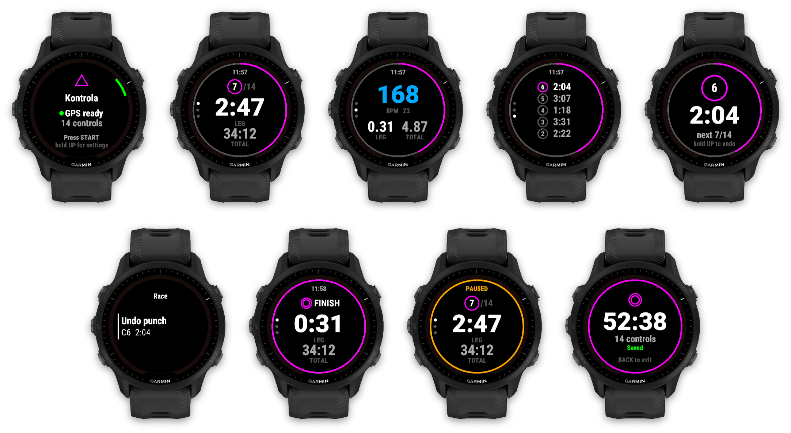
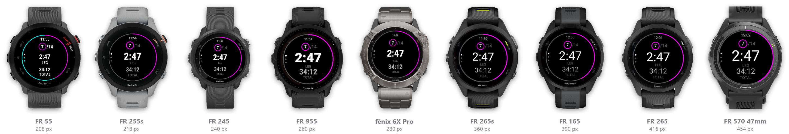
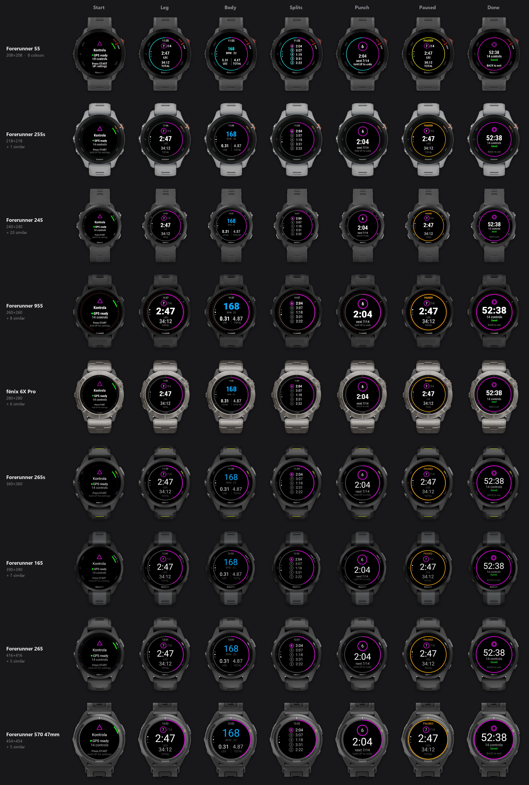

# Kontrola

Orienteering watch app for Garmin (Connect IQ).


Race mode for orienteering on Garmin watches. It records splits per control and has no
map, position or bearing on screen, so it's legal to wear in races.



- **Punch** a control with BACK: the watch vibrates and shows that leg's split
- **Undo** a wrong punch without stopping the timer
- **Course progress** ring around the edge, next control drawn as a course symbol
- **Splits** per leg in the FIT file, ready for analysis
- **61 watches**, from the 208 px FR55 to 454 px AMOLED

## Install

Not in the Connect IQ Store yet. To sideload: build (see [Development](#development)), connect
the watch over USB and copy `bin/Kontrola_<device>.prg` to `GARMIN/APPS/`.

## Usage

### Buttons

| Button | Before start | Recording | Paused |
|---|---|---|---|
| START | start | pause + menu | menu (Resume / Save / Discard) |
| BACK | exit | **punch control** (lap) | - |
| UP / DOWN | - | switch screens | switch screens |
| hold UP | settings (number of controls) | race menu: **undo punch** | - |

Touch is ignored on purpose.

**Undo punch**: hold UP while racing (timer keeps running), or use the pause menu. The current
leg then continues from the previous control, as if the wrong punch never happened.

### Screens

1. **Main**: next control (circle with number, `/14`; finish symbol after the last one), leg time, total time
2. **Body**: HR coloured by zone, leg distance, total distance
3. **Splits**: last 5 leg times

The magenta ring around the edge shows course progress. It turns yellow while paused.
After each punch the watch shows that leg's split for 4 s.

### Before the race

The only setup is the **number of controls** (no course is loaded, that keeps it race legal):

- **On the watch**: open Kontrola, **hold UP** on the start screen → Settings → Controls,
  pick the number, then press START.
- **In Garmin Connect**: device → Activities & Apps → Kontrola → Settings → Number of controls.
  Only for apps installed from the Connect IQ Store, not sideloaded ones.

It's remembered for the next race, so check it on the start screen ("14 controls" or
"Controls not set").
It drives the `7/14` count, the progress ring and the finish symbol. With 0 ("-", unknown)
punches and splits are still recorded, just without the ring and the `/14`.
It can't be changed once the timer runs (hold UP is then the race menu).

## Supported watches



Round screen, 5 buttons, Connect IQ 3.2+ (61 models, full list in `manifest.xml`):

- **Forerunner**: 55, 165 / 165 Music, 245 / 245 Music, 255 / 255S (+ Music), 265 / 265S, 570, 645 Music, 745, 945 / 945 LTE, 955, 965, 970
- **fēnix**: 5 Plus series, 6 series, 7 series (incl. Pro), 8 (AMOLED + Solar), E
- **epix** Gen 2 / Pro, **Enduro** / Enduro 3, **MARQ** Gen 1 / Gen 2, **Instinct** 3 AMOLED / Crossover AMOLED

Not supported: Venu / vívoactive (2 buttons, no way to switch screens or punch reliably),
Instinct MIP (non-round screen), Edge.

Sizes scale with the screen and fonts are picked per watch (biggest that fits), so the layout
holds from 208 px to 454 px.

<details>
<summary>Screens on every screen size (FR55 to FR570)</summary>



</details>

## FIT output

Recorded as Running / Trail with the activity name "Orienteering". Each lap is one leg, with these
extra fields:
- `leg` (lap): leg number, 1..N+1 (the last leg is control N to the finish).
  After an undo, two laps share the same `leg` number; add them together to get the real leg.
- `controls` (session): number of controls punched

## Development

### Build

Needs the Connect IQ SDK and a developer key in `~/.garmin-keys/developer_key.der`.

```powershell
./build.ps1                # FR955 -> bin/Kontrola_fr955.prg
./build.ps1 -Device fr965  # another watch
./build.ps1 -All           # every watch in manifest.xml
./build.ps1 -Run           # build + run in simulator
```

### Screenshots

`tools/screens.py` builds the demo app (`demo.jungle`: the real views fed with fake race data),
runs it in the Connect IQ simulator and grabs every screen. Each capture is put into the SDK's
own picture of that watch, so the images show the whole watch on a transparent background.

```powershell
pip install pillow numpy
python tools/screens.py               # one watch per screen size (~1 min each)
python tools/screens.py --fonts       # one per screen size + font set
python tools/screens.py --all         # every watch in manifest.xml
python tools/screens.py fr55 fr965    # just these
python tools/screens.py --sheet-only  # rebuild the sheets from the last captures
```

Output goes to `docs/screens/v<APP_VERSION>/`: `all.png` + `1_prestart.png`... (FR955),
`watches.png` (main screen on every watch) and `devices.png` (one row per watch, every screen).
Older versions are kept, never deleted. Windows only; the simulator window can stay behind
other windows while it runs.

## Changelog

See [CHANGELOG.md](CHANGELOG.md).

## Next ideas

- configurable data screens (layout + field per slot via settings)
- training mode (load course, bearing/distance, auto-punch)
