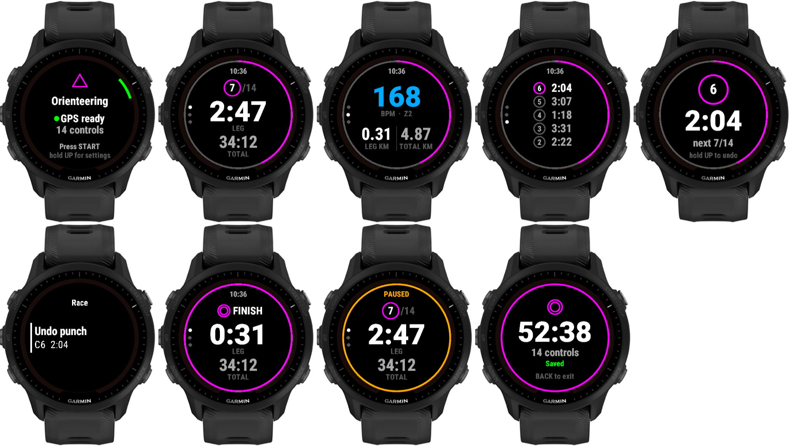

# Orienteering (Connect IQ watch app)

Race mode for orienteering on the Forerunner 955. It records splits per control and has no
map, position or bearing on screen, so it's legal to wear in races.



Screenshots for every version are kept in `docs/screens/vX.Y.Z/`; old ones are never deleted.
They come from `demo.jungle` (the real views fed with fake data):
`monkeyc -f demo.jungle -o bin/Demo_fr955.prg -y <key> -d fr955`, then run it in the simulator.

## Buttons

| Button | Before start | Recording | Paused |
|---|---|---|---|
| START | start | pause + menu | menu (Resume / Save / Discard) |
| BACK | exit | **punch control** (lap) | - |
| UP / DOWN | - | switch screens | switch screens |
| hold UP | settings (number of controls) | race menu: **undo punch** | - |

Touch is ignored on purpose.

**Undo punch**: hold UP while racing (timer keeps running), or use the pause menu. The current
leg then continues from the previous control, as if the wrong punch never happened.

## Screens

1. **Main**: next control (circle with number, `/14`; finish symbol after the last one), leg time, total time
2. **Body**: HR coloured by zone, leg distance, total distance
3. **Splits**: last 5 leg times

The magenta ring around the edge shows course progress (needs the number of controls set).
It turns yellow while paused.

After each punch the watch vibrates and shows that leg's split for 4 s.

## FIT output

Recorded as Running / Trail with the name "Orienteering". Each lap is one leg, with these
extra fields:
- `leg` (lap): leg number, 1..N+1 (the last leg is control N to the finish).
  After an undo, two laps share the same `leg` number; add them together to get the real leg.
- `controls` (session): number of controls punched

## Build

```powershell
./build.ps1        # build bin/Orienteering_fr955.prg
./build.ps1 -Run   # build + run in simulator
```

Number of controls can also be set from Garmin Connect app settings (0 = unknown).

## Next ideas

- configurable data screens (layout + field per slot via settings)
- training mode (load course, bearing/distance, auto-punch)
